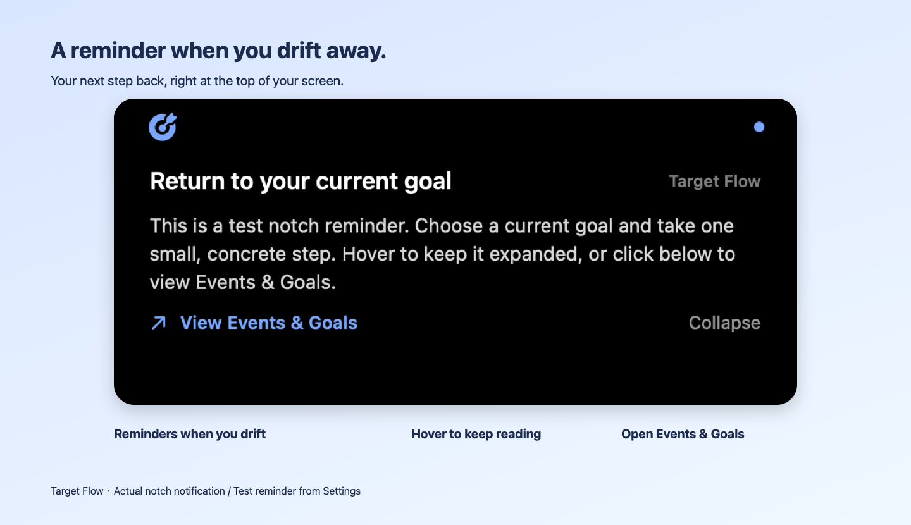
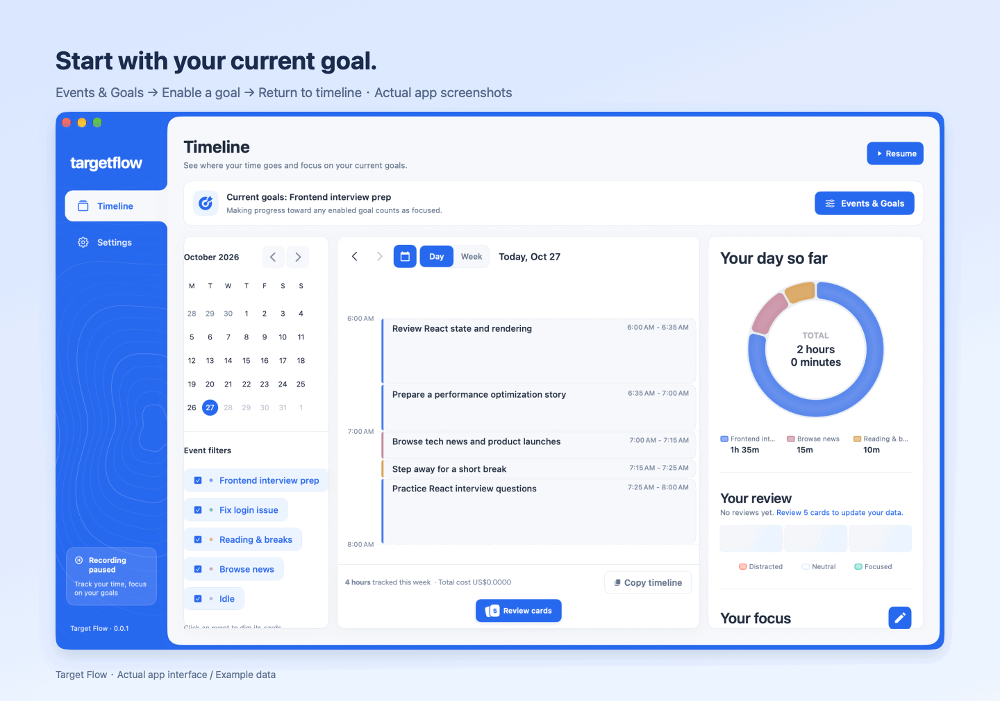
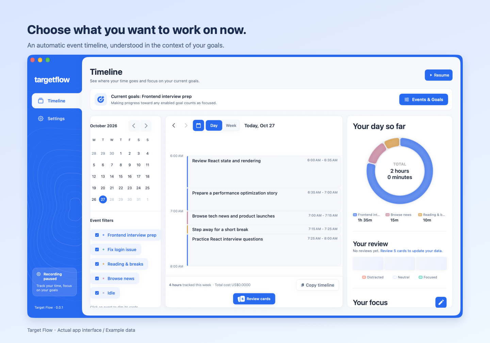
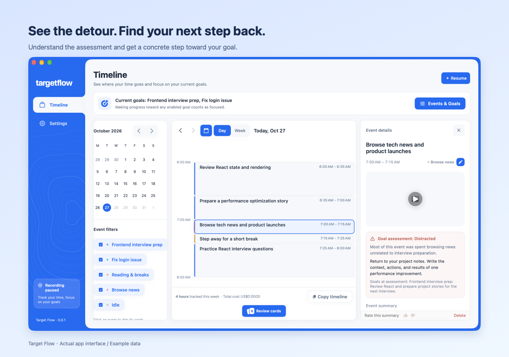

<div align="center">


<h1>Target Flow</h1>

<p><strong>A gentle nudge back to what you meant to do.</strong></p>

<p>A macOS app that turns screen activity into an automatic timeline,<br>spots detours from your current goals, and suggests one concrete step back.</p>

<p><strong>English</strong> · <a href="README.zh-CN.md">简体中文</a></p>

<h3>Download for macOS</h3>

<p>
  <a href="https://github.com/qqqqqcy/TargetFlow/releases/download/v0.0.1-test.1/TargetFlow-0.0.1-test-arm64.dmg"><strong>↓ Apple silicon (M-series)</strong></a>
  &nbsp; · &nbsp;
  <a href="https://github.com/qqqqqcy/TargetFlow/releases/download/v0.0.1-test.1/TargetFlow-0.0.1-test-x86_64.dmg"><strong>↓ Intel Mac</strong></a>
</p>

<p>macOS 14+ · v0.0.1 Test 1 · Free &amp; open source</p>

<p><sub>Ad-hoc signed test build, not notarized by Apple. If blocked on first launch,<br>go to System Settings → Privacy &amp; Security → Open Anyway after attempting to open the app.</sub></p>

<p><a href="https://github.com/qqqqqcy/TargetFlow/releases/tag/v0.0.1-test.1">Release notes &amp; checksums</a> · <a href="docs/test-release-install.txt">Installation help</a></p>

</div>

---

**Choose your current goal → Automatically identify events → Detect a detour → Remind you to return.**

## A reminder when you drift away

When a new event is assessed as neutral or distracted, Target Flow sends a reminder. For example, if you keep browsing unrelated news while preparing for an interview, it might suggest: **“Return to your project experience. Start by writing down the context, actions, and results of one performance optimization example.”** This gives you a clear, small step to start again.



*The image above shows an actual notch reminder window from the current app. Its text is the test reminder from Settings; automatic reminders use the return-to-goal suggestion for the corresponding event.*

No reminder is sent while you are making progress on any current goal. For a short break or insufficient evidence, the suggestion acknowledges that uncertainty instead of immediately labeling you distracted. Once a reminder appears, hover over it to read it, or click **“View Events & Goals”** to confirm what you want to work on next.

Reminders are triggered by new event analysis, which runs every 5 minutes by default, rather than making second-by-second judgments. The same recorded segment does not trigger repeated reminders. See [Reminder settings and behavior](#reminder-settings-and-behavior) for styles, sounds, and trigger conditions.

> The product images on this page show the current app's actual interface using separate, fictional example data. GIFs demonstrate steps using screenshots of real interactions. Event and assessment text illustrates the features; it does not represent real user records or the result of a live AI analysis.

## Keep reminders centered on your current goals

### 1. Write down what you want to work on now

Open **“Events & Goals”** at the top of the timeline, add or edit an event's name and description, then turn on its “Current Goal” switch.

Use the name to describe a specific task, and the description to clarify its scope and expected outcome. For example:

| Event name | Example description |
| --- | --- |
| Prepare for a frontend interview | Update my résumé, review React, and practice interview questions to prepare for the next interview round. |
| Fix the login issue | Investigate why login fails, update the code, and verify the login flow. |
| Write a project proposal | Organize requirements, compare implementation approaches, and complete a proposal ready for review. |

You can enable several current goals at once. **Making progress on any one of them counts as staying on track**; you do not need to work on all of them simultaneously.



You can adjust your goals at any time. Turning them all off keeps timeline recording running but stops goal assessments and reminders. After you enable, disable, or change a goal's name or description, assessments use records captured after that change. Changes to colors or ordering do not restart goal assessment.

### 2. Automatically record what happened

Once recording starts, Target Flow periodically captures screenshots and uses your configured provider to analyze activity. It creates event cards with time ranges, titles, and summaries that serve as the basis for goal assessments and reminders.



Events are organized around specific tasks: fixing a problem may involve an editor, a browser, and a terminal, so switching apps does not necessarily mean a new event. In the day or week timeline, you can view records, play back recordings, review, copy, or delete cards.

**The default card generation interval is 5 minutes.** You can change it to 10 or 15 minutes in “Settings → Recording & Reminders.” This controls how often a new round of analysis starts; a continuing event may still be merged into a single, longer card. Goal assessment runs with new event analysis, rather than making second-by-second judgments.

### 3. See how events relate to your goals

With current goals enabled, new events are assessed against them, with an explanation and a suggestion for returning to your goals when needed.



| Focus status | Assessment basis | Reminder behavior |
| --- | --- | --- |
| **Focused** | Advances at least one current goal, including necessary research, preparation, or supporting work. | No reminder |
| **Neutral** | Insufficient evidence, an unclear connection, a brief switch, or a reasonable break. | Offers a suggestion for returning, without treating uncertainty or a break as distraction |
| **Distracted** | Evidence shows sustained activity unrelated to all current goals for most of the assessed period. | Suggests a concrete step to return to a goal |

Focus status depends on how an event relates to your **current goals**. Even other valuable work may take you away from the direction you selected for now. Event tags help summarize and filter records; they do not directly determine assessments. Automatic judgments can be wrong, so review the reasoning on the card alongside the actual records.

## Reminder settings and behavior

In **“Settings → Recording & Reminders → Goal Reminders,”** you can test reminders or turn them off. Goal assessments remain available when reminders are disabled.

- **Notch notification (default):** Expands from the top of the screen containing the pointer. On screens without a notch, it appears at the top center. It needs no system notification permission and does not take keyboard focus. It offers 8 game sound effects, previews, and mute; the default is “Gem Collect.”
- **System notification (Notice):** Uses macOS notification banners and the default alert sound, subject to system notification permissions, sound settings, and Focus modes.

Both reminder styles can open “Events & Goals” so you can adjust your current direction. A notch notification collapses after 12 seconds. Hovering keeps it expanded; after the pointer leaves, it collapses after 5 seconds. You can also collapse it manually.

Reminders are triggered after a new event assessment, with no additional cooldown. The same recorded segment does not trigger repeated reminders, and only events that ended within the last 30 minutes are eligible. Switching reminder styles or disabling reminders clears existing goal reminders.

For sound sources, see [Notification sound notes](docs/notification-sounds.md).

## Getting started

1. Launch the app and configure your own API, local model, or CLI provider.
2. Follow the setup guide to grant screen recording permission and start recording.
3. In the timeline's “Events & Goals,” describe specific tasks and enable one or more current goals.
4. Wait for event cards to appear, review their focus status, and test your preferred reminder style in Settings.

The menu bar offers recording, pause, open-window, and “Quit Completely” actions. Closing the window or quitting normally may leave the app running in the menu bar. Use “Quit Completely” when you need to end the process fully.

### Interface language

Use the language menu in the **Settings header** to choose **English** or **简体中文**. Changes require a full restart: quit the app completely and reopen it to apply the new interface language. You can use “Quit Completely” in the menu bar to fully exit.

## Recording, privacy, and costs

Screen recordings and the database are stored locally. **When you use a cloud provider, the activity data needed for analysis is sent to that provider.** Local storage does not mean analysis is fully offline. Consider the provider's data handling practices and your own use case when choosing one.

- In “Settings → Privacy,” choose apps to exclude from screen recording.
- In “Settings → Recording & Reminders,” adjust screenshot frequency, view recording and playback storage usage, set storage limits, and clean up data.
- In “Settings → Providers,” configure primary and backup providers.
- The bottom-left corner of the timeline shows cumulative API costs recorded by the app. Click to view recorded input/output tokens and cost coverage. The amount is not limited to the current week, and retries count too. If a provider does not return pricing, the cost is shown as unknown; unknown amounts are not counted as zero. Token usage from a subscription-based CLI does not imply an additional bill.

## Installation and local builds

### Download a test build

Download a DMG from [GitHub Releases](https://github.com/qqqqqcy/TargetFlow/releases). Choose `arm64` for Apple silicon (M-series) or `x86_64` for Intel Macs. Requires macOS 14 or later. Open the DMG and drag `TargetFlow.app` into Applications.

Test builds are ad-hoc signed and have not been notarized by Apple. If macOS blocks the first launch, attempt to open the app, then go to **System Settings → Privacy & Security → Open Anyway** and confirm. Only approve a download you trust. Updating a test build may require granting Screen Recording permission again. See the [installation instructions](docs/test-release-install.txt).

### Build your own test DMG

```bash
bash scripts/package-test.sh
# Cross-build for Intel:
TARGETFLOW_TEST_ARCH=x86_64 bash scripts/package-test.sh
```

The script creates an ad-hoc signed DMG and SHA-256 checksum in `dist/`. It does not publish a release or install the app. Move an existing package aside before rebuilding the same version and architecture.

Source builds require full Xcode: Command Line Tools alone cannot build this macOS app. The app deployment target is macOS 14, and the test target requires macOS 15.1.

### Using Xcode

```bash
open Dayflow/Dayflow.xcodeproj
```

Select the `Dayflow` scheme, set your own signing team in Signing & Capabilities, and run. The project and Swift module are still named `Dayflow`; the built app is `TargetFlow.app`.

### Build and install in Applications

First, list the available code signing certificates:

```bash
security find-identity -v -p codesigning
```

Save the chosen certificate's SHA-1 to `scripts/local-signing-identity` (a single line; this file is ignored by Git), then run:

```bash
bash scripts/run-local.sh
```

You can also specify a signing identity through an environment variable, which takes precedence over the local configuration file:

```bash
TARGETFLOW_SIGNING_IDENTITY="Apple Development: Your Name (TEAMID)" \
  bash scripts/run-local.sh
```

The script builds the app, verifies its signature, closes Target Flow processes running under the current user, waits for them to exit, installs to `/Applications/TargetFlow.app`, and reopens it. If the app does not exit within 30 seconds, installation stops and the original app is preserved.

To build and verify only, without installing or closing the app:

```bash
bash scripts/run-local.sh --build-only
```

For everyday use, keep the signing certificate, app identifier, and installation path consistent to avoid losing screen recording authorization after rebuilding. The script stops if no certificate is configured. For temporary verification, you can explicitly use `TARGETFLOW_SIGNING_IDENTITY=-`, but an ad hoc signature's identity changes with the app's contents, making it unsuitable for everyday installations that need to retain screen recording authorization. Do not use `CODE_SIGNING_ALLOWED=NO` to build an app for everyday use.

### Screen recording permission

On first launch, click “Open System Settings” and enable TargetFlow under “Privacy & Security → Screen & System Audio Recording” (the label varies by macOS version). If the app is missing from the list, click `+` and add `/Applications/TargetFlow.app`. Screen recording does not require Accessibility permission.

The app automatically checks permission again when you return. If the switch is enabled but permission has not taken effect, click “Quit and Reopen.” Setup can continue only after the system permission check succeeds.

If you previously ran an unsigned build or changed signing identities, macOS may retain permission for the old identity. In that case, fully quit the app, reset its screen recording permission, then reopen it and grant permission again:

```bash
tccutil reset ScreenCapture local.targetflow.app
open /Applications/TargetFlow.app
```

This is only for resolving permissions tied to an old signature; it is not required at every launch. The build script does not create certificates, change Keychain trust, or automatically reset permissions.

### Unit tests

```bash
xcodebuild -project Dayflow/Dayflow.xcodeproj \
  -scheme Dayflow -destination 'platform=macOS' \
  -only-testing:DayflowTests CODE_SIGNING_ALLOWED=NO test
```

## Project origins and scope

Target Flow is based on upstream [Dayflow](https://github.com/JerryZLiu/dayflow) commit `730d6f84` (v2.7.5), retaining its Git history and MIT license, with a focus on **current goals, an automatic timeline, and reminders when you drift away**.

Daily reports, standalone weekly reports, chat, Flow, Agents, accounts/subscriptions, referrals, MCP/CLI integration settings, export settings, and other settings are not offered as app features. The original update checks, feature promotions, and telemetry do not start, and the Dayflow CLI is not bundled during builds. Some upstream source code and database tables remain to maintain shared dependencies, without corresponding app entry points or startup tasks.

Target Flow can coexist with Dayflow, using its own app identity and data locations:

| Item | Value |
| --- | --- |
| App identifier | `local.targetflow.app` |
| Data directory | `~/Library/Application Support/TargetFlow/` |
| API key service prefix | `local.targetflow.apikeys` |
| URL scheme | `targetflow://` (start/stop recording) |

Recordings, databases, preferences, and keys from an installed copy of Dayflow are not imported automatically. Providers and screen recording permission must be configured separately.

For brand assets and regeneration instructions, see [App icons and brand assets](docs/images/README.md).

## License

Inherits the upstream [MIT License](LICENSE), retaining the original author's copyright notice.
