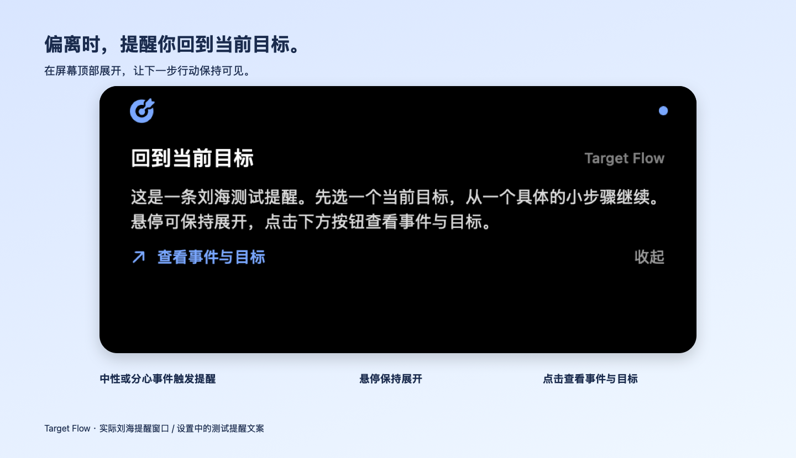
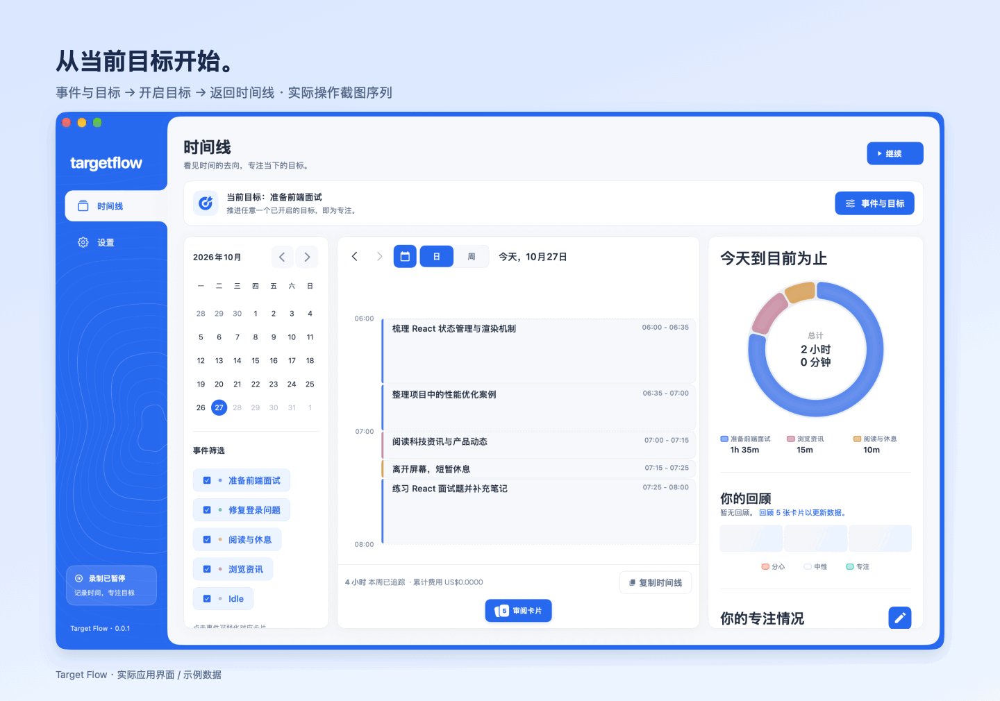
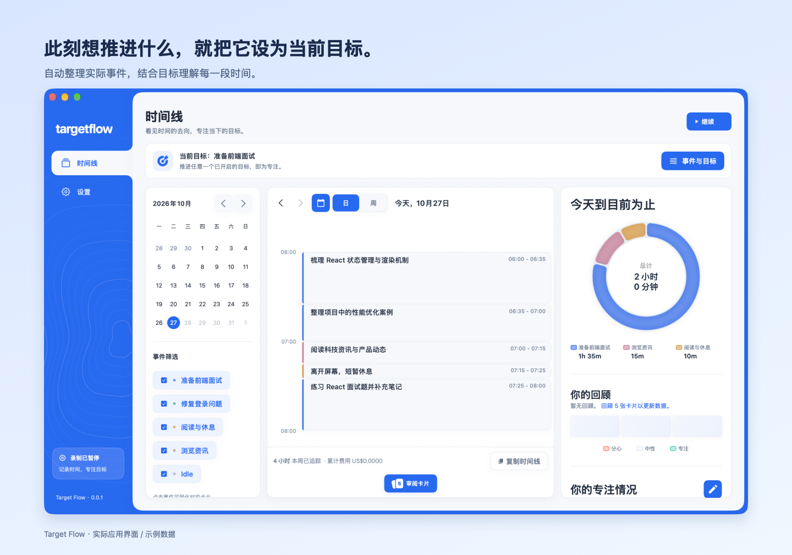
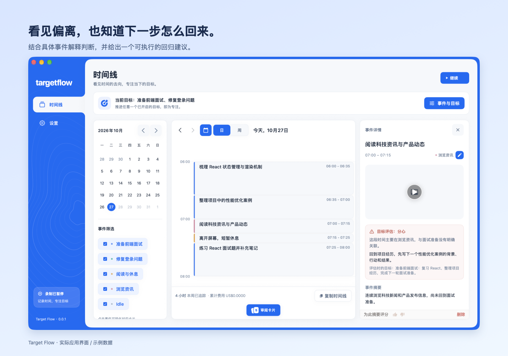

<div align="center">


<h1>Target Flow</h1>

<p><strong>偏离时，提醒你回到当前目标。</strong></p>

<p>一款 macOS 目标提醒应用：自动整理屏幕活动，识别与当前目标的偏离，<br>给你一个具体的小步骤，重新开始。</p>

<p><a href="README.md">English</a> · <strong>简体中文</strong></p>

<h3>下载 macOS 测试版</h3>

<p>
  <a href="https://github.com/qqqqqcy/TargetFlow/releases/download/v0.0.1-test.1/TargetFlow-0.0.1-test-arm64.dmg"><strong>↓ Apple 芯片（M 系列）</strong></a>
  &nbsp; · &nbsp;
  <a href="https://github.com/qqqqqcy/TargetFlow/releases/download/v0.0.1-test.1/TargetFlow-0.0.1-test-x86_64.dmg"><strong>↓ Intel Mac</strong></a>
</p>

<p>macOS 14+ · v0.0.1 Test 1 · 免费开源</p>

<p><sub>临时签名测试版，未经 Apple 公证。若首次打开被阻止，请尝试启动后前往<br>「系统设置 → 隐私与安全性 → 仍要打开」并确认。</sub></p>

<p><a href="https://github.com/qqqqqcy/TargetFlow/releases/tag/v0.0.1-test.1">版本说明与校验文件</a> · <a href="docs/test-release-install.txt">安装帮助</a></p>

</div>

---

**选定当前目标 → 自动识别事件 → 发现偏离 → 提醒你回来。**

## 偏离时，提醒你回来

当新事件被判断为中性或分心时，Target Flow 会发出偏离提醒。比如准备面试时持续浏览无关资讯，提醒可以建议：**「回到项目经历，先写下一个性能优化案例的背景、行动和结果。」** 让你能从一个明确的小步骤重新开始。



*上图是当前应用实际弹出的刘海提醒窗口，正文为设置中的测试提醒；自动提醒的正文来自对应事件的回归建议。*

推进任意当前目标时不会提醒。短暂休息或证据不足时，建议会承认这种不确定性，不直接把你判为分心。提醒显示后可以悬停阅读，或点击 **「查看事件与目标」** 确认接下来想推进的事情。

提醒随新事件分析触发，默认分析间隔为 5 分钟，并非逐秒判断。同一段记录不重复提醒。提醒样式、声音及触发范围见[提醒设置与行为](#提醒设置与行为)。

> 本页产品图来自当前应用的实际界面，使用独立的虚构示例数据。GIF 是真实操作截图组成的步骤演示；事件及评估文字用于说明功能，不代表真实用户记录或一次现场 AI 分析结果。

## 让提醒围绕你此刻的目标

### 1. 写下此刻想推进的事情

在时间线顶部打开 **「事件与目标」**，添加或编辑事件名称与说明，再开启它的「当前目标」开关。

名称描述具体事情，说明补充范围和预期成果。例如：

| 事件名称 | 说明示例 |
| --- | --- |
| 准备前端面试 | 修改简历、复习 React、练习面试题，为下一轮面试做准备。 |
| 修复登录问题 | 排查登录失败原因，修改代码并验证登录流程。 |
| 撰写项目方案 | 整理需求、比较实现方案，完成可供评审的方案文档。 |

可以同时开启多个当前目标。**推进其中任意一个，就符合当前方向**，无需同时推进所有目标。



目标可以随时调整。全部关闭后，应用继续记录时间线，但停止目标评估和偏离提醒。开启、关闭或修改目标名称与说明后，评估以变更后的记录为准；颜色和排序调整不会重新开始目标评估。

### 2. 自动记录发生了什么

开始录制后，Target Flow 定期截取屏幕画面，通过你配置的提供商分析活动，生成带有时间范围、标题和摘要的事件卡片，为目标评估和偏离提醒提供依据。



事件围绕具体事情组织：修复一个问题可能跨越编辑器、浏览器和终端，切换应用不一定意味着新事件。你可以在日／周时间线中查看记录、回放、复核、复制或删除卡片。

**卡片生成间隔默认 5 分钟**，可在「设置 → 记录与提醒」中改为 10 或 15 分钟。它控制启动新一轮分析的频率；连续发生的同一事件仍可能合并为一张更长的卡片。目标评估随新事件分析进行，并非逐秒判断。

### 3. 看见事件与目标的关系

开启当前目标后，新事件会接受目标评估，并展示判断理由及必要的回归建议。



| 专注状态 | 判断依据 | 是否提醒 |
| --- | --- | --- |
| **专注** | 推进至少一个当前目标，包括必要的研究、准备或支持工作。 | 不提醒 |
| **中性** | 证据不足、关联不明确、短暂切换或合理休息。 | 提供回归建议，不把不确定或休息直接说成分心 |
| **分心** | 有证据表明，在评估时段的大部分时间里持续进行与所有当前目标无关的事情。 | 建议一个返回目标的具体步骤 |

专注状态取决于事件与**当前目标**的关系。即使是在处理另一件有价值的工作，也可能偏离此刻选定的方向。事件标签用于归纳和筛选，不直接决定评估结果。自动判断可能存在误差，可结合卡片中的理由和实际记录查看。

## 提醒设置与行为

在 **「设置 → 记录与提醒 → 目标提醒」** 中可以测试提醒效果或关闭偏离提醒。关闭提醒后仍可查看目标评估。

- **刘海通知（默认）**：从鼠标所在屏幕的顶部展开；没有刘海的屏幕显示在顶部中央。不需要系统通知权限，不抢键盘焦点。支持 8 种游戏音效、试听和静音，默认「宝石收集」。
- **系统通知（Notice）**：使用 macOS 通知横幅和默认提示音，受系统通知权限、声音设置和专注模式影响。

两种提醒都可以打开「事件与目标」，便于调整当前方向。刘海通知在 12 秒后收回；悬停可保持展开，移开后 5 秒收回，也可以手动收起。

提醒在新事件评估后触发，没有额外冷却间隔；同一段记录不重复提醒，只提示最近 30 分钟内结束的事件。切换提醒样式或关闭提醒会清理现有目标提示。

音效来源见[通知音效说明](docs/notification-sounds.md)。

## 首次使用

1. 启动应用，配置自己的 API、本地模型或 CLI 提供商。
2. 按引导授予屏幕录制权限，开始录制。
3. 在时间线的「事件与目标」中写下具体事情，开启一个或多个当前目标。
4. 等待事件卡片生成，查看专注状态，并在设置中测试喜欢的提醒方式。

菜单栏提供录制、暂停、打开窗口和「Quit Completely」等操作。关闭窗口或普通退出可能让应用继续留在菜单栏；需要彻底结束进程时使用「Quit Completely」。

### 界面语言

在「设置」标题栏的语言菜单中选择 **English** 或 **简体中文**。更改后需要完全退出并重新打开应用，新的界面语言才会生效；可使用菜单栏的「Quit Completely」彻底退出。

## 记录、隐私与费用

录屏和数据库保存在本机。**使用云端提供商时，分析所需的活动数据会发送到该提供商**；本地存储不代表分析过程完全离线。选择提供商时，请结合其数据处理方式和你的使用场景。

- 在「设置 → 隐私」中选择不参与屏幕录制的应用。
- 在「设置 → 记录与提醒」中调整截屏频率、查看录制与回放空间用量、设置存储上限和清理数据。
- 在「设置 → 提供商」中配置主／备用提供商。
- 时间线左下角显示应用内累计接口费用，点击可查看已记录的输入／输出 token 和费用覆盖情况。金额不限本周，重试也计入；提供商未返回价格时显示费用未知，不将未知金额算作零。订阅制 CLI 的 token 用量不代表额外账单。

## 安装与本地构建

### 下载测试版

在 [GitHub Releases](https://github.com/qqqqqcy/TargetFlow/releases) 下载 DMG：Apple 芯片（M 系列）选择 `arm64`，Intel Mac 选择 `x86_64`。要求 macOS 14 或更高版本。打开 DMG，将 `TargetFlow.app` 拖入「应用程序」。

测试包使用临时签名，未经 Apple 公证。如果 macOS 阻止首次启动，请先尝试打开应用，再前往 **「系统设置 → 隐私与安全性 → 仍要打开」** 并确认。仅对你信任的下载执行此操作。更新测试版后，可能需要重新授予屏幕录制权限。详见[安装说明](docs/test-release-install.txt)。

### 自行打包测试 DMG

```bash
bash scripts/package-test.sh
# 交叉构建 Intel 版本：
TARGETFLOW_TEST_ARCH=x86_64 bash scripts/package-test.sh
```

脚本在 `dist/` 中生成临时签名 DMG 和 SHA-256 校验文件，不会发布 Release 或安装应用。重新打包相同版本和架构前，请先移走已有安装包。

源码构建需要完整 Xcode，仅安装 Command Line Tools 无法构建此 macOS 应用。应用部署目标为 macOS 14，测试目标为 macOS 15.1。

### 使用 Xcode

```bash
open Dayflow/Dayflow.xcodeproj
```

选择 `Dayflow` scheme，在 Signing & Capabilities 中设置自己的签名团队，然后运行。项目和 Swift 模块仍名为 `Dayflow`，构建产物为 `TargetFlow.app`。

### 构建并安装到「应用程序」

先查看可用的代码签名证书：

```bash
security find-identity -v -p codesigning
```

将选定证书的 SHA-1 保存到 `scripts/local-signing-identity`（单行，该文件已被 Git 忽略），然后运行：

```bash
bash scripts/run-local.sh
```

也可以通过环境变量指定签名身份，它优先于本地配置文件：

```bash
TARGETFLOW_SIGNING_IDENTITY="Apple Development: Your Name (TEAMID)" \
  bash scripts/run-local.sh
```

脚本会构建、验证签名，关闭当前用户正在运行的 Target Flow，等待退出后安装到 `/Applications/TargetFlow.app` 并重新打开。如果应用在 30 秒内没有退出，安装停止并保留原应用。

只构建和验证，不安装或关闭应用：

```bash
bash scripts/run-local.sh --build-only
```

日常运行请保持签名证书、应用标识和安装路径一致，避免重编译后录屏授权失效。没有配置证书时脚本会停止。临时验证可显式使用 `TARGETFLOW_SIGNING_IDENTITY=-`，但临时签名的身份随程序内容变化，不适合需要持续保留录屏授权的日常安装。不要使用 `CODE_SIGNING_ALLOWED=NO` 构建日常运行版本。

### 屏幕录制权限

首次启动点击「打开系统设置」，在「隐私与安全性 → 录屏与系统录音」（部分 macOS 版本称「屏幕与系统音频录制」）中开启 TargetFlow。如果列表中没有应用，点击 `+` 添加 `/Applications/TargetFlow.app`。屏幕录制不需要辅助功能权限。

返回应用后会自动重新检查权限。开关已开启但权限仍未生效时，点击「退出并重新打开」。只有系统权限检查成功，才能继续引导。

如果曾运行未签名的版本或更换签名身份，系统可能保留旧身份的授权。此时先完全退出应用，再重置本应用的录屏授权，重新打开并授权：

```bash
tccutil reset ScreenCapture local.targetflow.app
open /Applications/TargetFlow.app
```

这仅用于处理旧签名授权，不是每次启动的必要步骤。构建脚本不会创建证书、修改钥匙串信任或自动重置权限。

### 单元测试

```bash
xcodebuild -project Dayflow/Dayflow.xcodeproj \
  -scheme Dayflow -destination 'platform=macOS' \
  -only-testing:DayflowTests CODE_SIGNING_ALLOWED=NO test
```

## 项目来源与边界

Target Flow 基于 [Dayflow](https://github.com/JerryZLiu/dayflow) 的上游提交 `730d6f84`（v2.7.5），保留其 Git 历史和 MIT 许可证，功能聚焦于**当前目标、自动时间线和偏离提醒**。

日报、独立周报、聊天、Flow、Agents、账户／订阅、推荐计划、MCP／CLI 接入设置、导出设置及其他设置不作为应用功能提供。原版更新检查、功能推广和遥测不启动，构建时不捆绑 Dayflow CLI。部分上游源码与数据库表仍保留以维护共享依赖，没有对应的应用入口或启动任务。

Target Flow 可与 Dayflow 并存，使用独立的应用身份和数据位置：

| 项目 | 值 |
| --- | --- |
| 应用标识 | `local.targetflow.app` |
| 数据目录 | `~/Library/Application Support/TargetFlow/` |
| API 密钥服务前缀 | `local.targetflow.apikeys` |
| URL scheme | `targetflow://`（录制开始／停止） |

不会自动导入已安装 Dayflow 的录屏、数据库、偏好或密钥，需要单独配置提供商并授权屏幕录制。

品牌素材与重新生成方式见[应用图标与品牌素材](docs/images/README.md)。

## 许可证

继承上游 [MIT License](LICENSE)，保留原作者版权声明。
